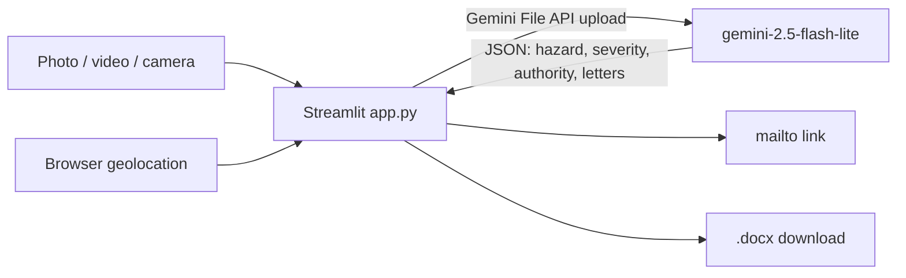

# TheekKaro.ai

> Upload a photo or short video of a civic hazard (pothole, exposed wiring, open manhole) and Google Gemini drafts a formal complaint letter in English and Urdu, so a citizen can file a report in minutes instead of writing it by hand.

**Status:** Hackathon prototype — AI Seekho 2026 Hackathon, May 2026 · Not currently deployed: the original Cloud Run instance returns HTTP 500 (checked 2026-10-28), so no live link is given
**Demo:** none live today. A UI mockup is at [`app_mockup.png`](app_mockup.png).

## What it does

`app.py` is a single Streamlit page (about 650 lines). The user:

1. uploads an image or video (`mp4`, `mov`, `jpg`, `jpeg`, `png`) or takes a photo with the camera;
2. optionally shares browser geolocation, which is reverse-geocoded with Nominatim (`geopy`); otherwise the location defaults to "Karachi, Pakistan";
3. gets back one Gemini call's JSON result: hazard description, severity (Low / Medium / High / Critical), the *name* of the likely Pakistani authority, a public email for it (or "Not Found"), and the complaint letter in English and Urdu;
4. can open the English letter in their mail client through a `mailto:` link, or download both letters as a `.docx`.

Nothing is sent anywhere on the user's behalf.



Other pieces: rotation across several Gemini API keys with failover (`get_api_keys()` and the retry loop in `app.py`), salvage parsing for malformed JSON, and temp-file cleanup after each request.

## Quickstart

Requires Python 3.10 or newer (the Dockerfile uses 3.10) and at least one Gemini API key.

```bash
git clone https://github.com/HamzaKhanBUIC/TheekKaro.ai.git
cd TheekKaro.ai
pip install -r requirements.txt
export GEMINI_API_KEYS="AIza...,AIza..."     # PowerShell: $env:GEMINI_API_KEYS="AIza..."
streamlit run app.py
```

Streamlit serves on `http://localhost:8501`. `python app.py` does not work for a Streamlit app.

Docker (the image runs `streamlit run app.py` on port 8080):

```bash
docker build -t theekkaro-engine .
docker run -p 8080:8080 -e GEMINI_API_KEYS="AIza..." theekkaro-engine
```

The repo includes no Cloud Run deployment script; the earlier README's `gcloud` commands were generic and have been removed.

## Configuration

| Variable | Required | Purpose |
| :-- | :-- | :-- |
| `GEMINI_API_KEYS` | yes | One or more Gemini API keys (pattern `AIza` + 35 characters), separated by commas or whitespace. Read from the environment first, then from Streamlit secrets (`.streamlit/secrets.toml`) |

The model (`gemini-2.5-flash-lite`) is hard-coded in `app.py`.

## Limitations

- **Not a dispatch or tracking platform.** There is no ticket system, database, department routing, event bus, status tracking or dashboard. Gemini only suggests an authority name and email in its JSON; the AI-generated email may be wrong (the app's own disclaimer says so).
- **Image or video only.** There is no free-text description input.
- **Not deployed.** The earlier Cloud Run URL returns HTTP 500. The README previously linked it as the live app.
- **Free-tier Gemini inputs may be used by Google for training.** The app shows a privacy disclaimer; do not upload sensitive content.
- **Account-wide file wipe.** On a quota error, `repair_node()` deletes all files uploaded under the failing Gemini key, which is unsafe on a shared key.
- **Old pinned dependencies.** `streamlit==1.33.0`, `python-dotenv==1.0.1` and `geopy==2.4.1` have published advisories; the audit recommended upgrading.
- **No tests, no CI.**
- **Unused files.** `index.html`, `style.css` and `script.js` are a separate static landing page, not part of the Streamlit app. `TheekKaro.ai` in the repo root is an empty git submodule pointer (gitlink) with no content.
- [`PROBLEMS.md`](PROBLEMS.md) and [`GCP_ISSUES.md`](GCP_ISSUES.md) are the author's notes on problems and Cloud Run issues met during the hackathon.

## License

MIT, see [LICENSE](LICENSE).
