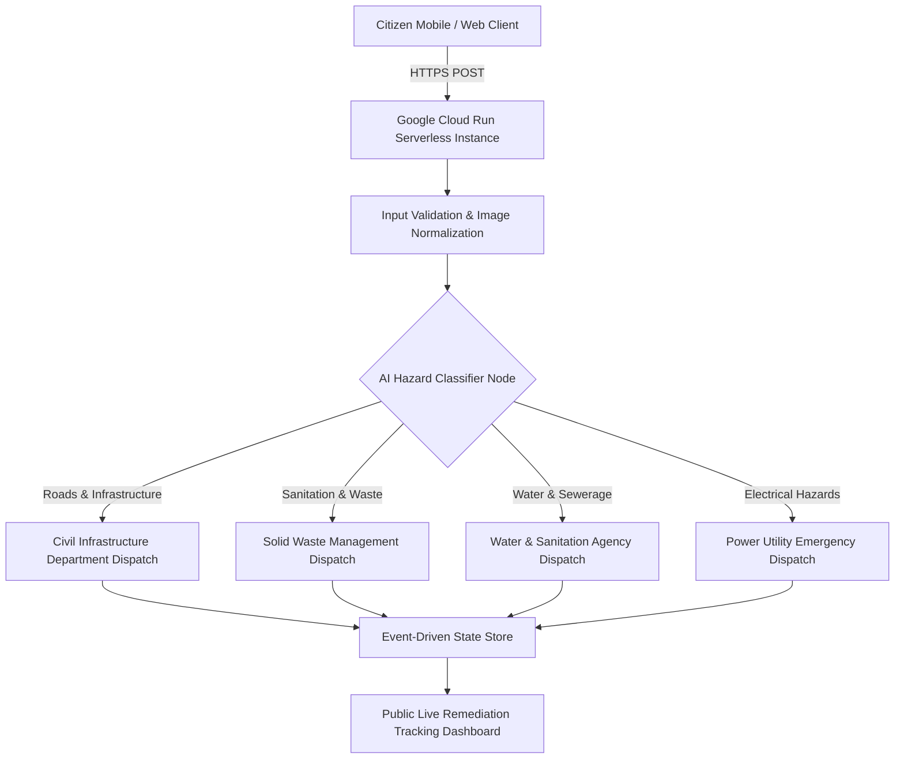

# TheekKaro.ai: AI-Powered Civic Complaint System

> Serverless, event-driven civic complaint classification and municipal remediation platform deployed on Google Cloud Run for urban municipal governance in Pakistan.

[](https://theekkaro-engine-900492834451.us-central1.run.app/)
[](https://www.python.org/)
[](https://www.docker.com/)
[](LICENSE)

---

## Live Production Deployment

- **Production Endpoint**: [https://theekkaro-engine-900492834451.us-central1.run.app/](https://theekkaro-engine-900492834451.us-central1.run.app/)

---

## Overview

Municipal complaint systems in developing urban centers suffer from high administrative friction, misrouted department tickets, and lack of transparency. Citizens reporting potholes, burst water mains, or hazardous electrical cables frequently submit ambiguous reports that languish in bureaucratic queues.

**TheekKaro.ai** automates the civic remediation lifecycle. It provides an intuitive, multilingual interface where citizens upload images or text descriptions of municipal hazards. The backend processes the input via AI classification models, extracts geographic coordinates, routes tickets to the responsible municipal department (e.g., KMC, Water Board, K-Electric), and tracks remediation status in real time.

---

## System Architecture



---

## Core Features

- **Automated Hazard Triage**: Natural language parsing of mixed English/Urdu problem descriptions into structured priority tickets.
- **Serverless Cloud Architecture**: Fully containerized and deployed on **Google Cloud Run**, automatically scaling to zero during idle periods to minimize operational costs.
- **Public Auditability**: Generates trackable ticket hashes enabling citizens to monitor municipal department resolution times.

---

## Repository Structure

```
.
├── app.py                    # Flask/FastAPI serverless backend application
├── Dockerfile                # Production multi-stage Docker container specification
├── requirements.txt          # Python runtime dependencies
├── index.html                # Frontend citizen reporting interface
├── script.js                 # Client-side form handling and geolocation capture
├── style.css                 # Responsive UI styling
├── GCP_ISSUES.md             # Cloud Run deployment and infrastructure debugging log
├── PROBLEMS.md               # Municipal domain problem analysis and triage rubric
├── app_mockup.png            # Visual UI mockups and flow diagrams
└── README.md                 # Technical documentation
```

---

## Getting Started

### Prerequisites
- Python 3.11+
- [Docker](https://www.docker.com/) (for containerized execution)
- Google Cloud SDK (`gcloud`) for cloud deployment

### Local Development
```bash
# Clone the repository
git clone https://github.com/HamzaKhanBUIC/TheekKaro.ai.git
cd TheekKaro.ai

# Install Python dependencies
pip install -r requirements.txt

# Launch local development server
python app.py
```

### Docker Container Build & Run
```bash
# Build the production Docker image
docker build -t theekkaro-engine .

# Run the container locally on port 8080
docker run -p 8080:8080 -e PORT=8080 theekkaro-engine
```

---

## Cloud Deployment (Google Cloud Run)

The application is deployed using Google Cloud Build and Cloud Run:

```bash
# Submit build to Google Artifact Registry
gcloud builds submit --tag gcr.io/[PROJECT_ID]/theekkaro-engine

# Deploy to Cloud Run with unauthenticated public access
gcloud run deploy theekkaro-engine \
  --image gcr.io/[PROJECT_ID]/theekkaro-engine \
  --platform managed \
  --region us-central1 \
  --allow-unauthenticated
```

---

## License

MIT License - see [LICENSE](LICENSE) for details.
```
